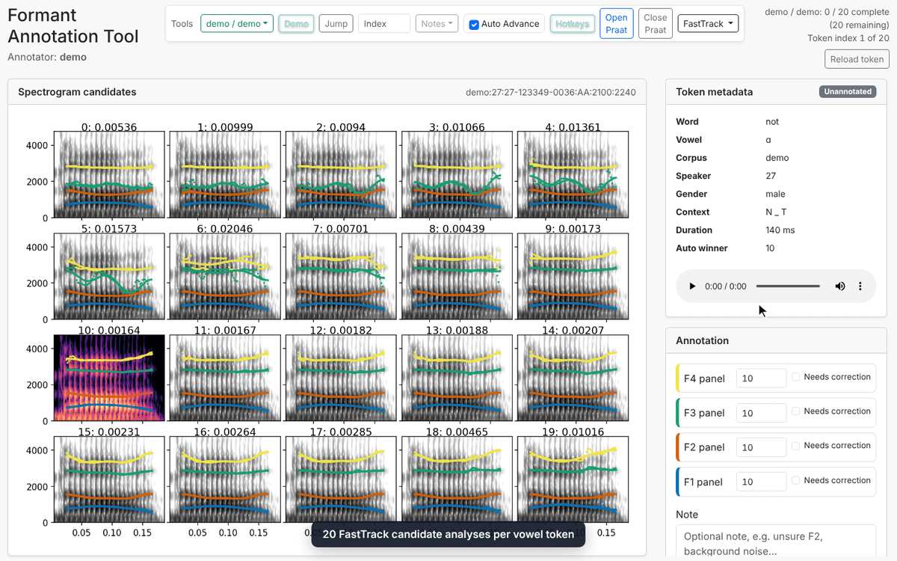
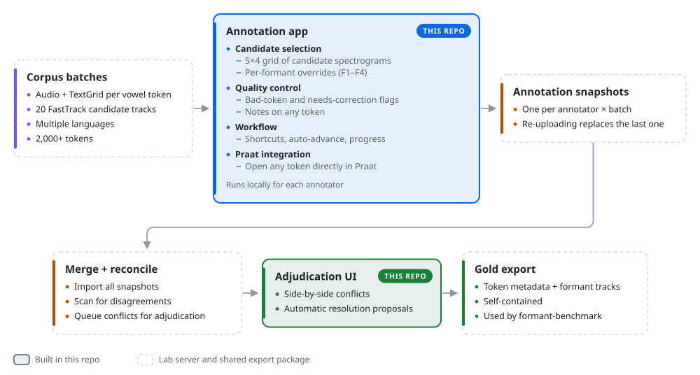

# Formant Annotation Tool

**A web app and data workflow for building a hand-verified formant dataset.**
Annotators compare 20 automatic formant analyses of each vowel and pick the best one, one formant at a time. Their work is then reconciled across annotators, adjudicated, and exported as gold data for linguistic analysis.

Built for the [Montréal Computational & Quantitative Linguistics Lab](https://mcqll.org/) (MCQLL), where it replaced a manual workflow. Two researchers have used it to label **5,000+ speech tokens**.

<p align="center">
  
</p>

<p align="center">
  
  
  
  
  
</p>

## Why it exists

Automatic formant trackers make errors, and the lab needed a gold-standard dataset to measure those errors. For each vowel token, [FastTrack](https://github.com/santiagobarreda/FastTrack) produces 20 candidate analyses with different settings. A person has to decide which candidate tracks each formant (F1–F4) correctly. Before this tool, that would require opening images and Praat by hand and keeping track of decisions in a spreadsheet, with no clean way to merge two annotators' work.

## How it works

<picture>
  <source media="(prefers-color-scheme: dark)" srcset="docs/media/workflow-dark.svg">
  
</picture>

- **Annotation app.** A FastAPI and SQLAlchemy backend with a vanilla JavaScript frontend split into small ES modules. It runs locally for each annotator, with its own SQLite database.
- **Candidate selection.** Clicking a candidate sets all four formants, a number overrides a single formant, and Shift-click selects and saves in one step. Space accepts the automatic winner, and the next token loads automatically.
- **Quality control.** Tokens can be flagged as bad or as needing correction, and any token can have a note.
- **Praat integration.** Any token opens directly in Praat.
- **Reconciliation and adjudication.** Snapshots from all annotators are merged and scanned for formant-level disagreements. Conflicts go to a separate adjudication UI that shows them side by side and proposes resolutions automatically.
- **Gold export.** A self-contained export of token metadata and formant tracks, read directly by [formant-benchmark](https://github.com/iangif/formant-benchmark) to evaluate formant trackers.

## Try the demo

The repo ships with a 20-token demo corpus, so you can try the full annotation interface without lab data or server access.

```bash
git clone https://github.com/iangif/formant-annotation-tool
cd formant-annotation-tool
./scripts/demo.sh          # needs uv: https://docs.astral.sh/uv/
```

Then open <http://127.0.0.1:8000>. Click **Hotkeys** to see the shortcuts.

The demo doesn't include reconciliation, adjudication or gold export. Those depend on the lab server and a lab-only export package.

<details>
<summary><b>Keyboard shortcuts</b></summary>

| Key | Action |
|---|---|
| <kbd>←</kbd> / <kbd>→</kbd> | Previous / next token without saving |
| <kbd>Space</kbd> | Accept the automatic winner |
| Click panel | Set F1–F4 to that candidate |
| <kbd>Shift</kbd> + click | Set F1–F4 and save immediately |
| <kbd>1</kbd>–<kbd>4</kbd> | Focus the F1–F4 field to override one formant |
| <kbd>Enter</kbd> | Save the current fields |
| <kbd>B</kbd> | Mark the token as bad |
| <kbd>X</kbd> | Toggle *needs correction* for the focused formant |
| <kbd>N</kbd> | Focus the note box |

</details>

## Project layout

```text
app/
  main.py             FastAPI entry point (annotate + adjudicate pages)
  routes/             REST API: batches, tokens, annotations, notes, Praat, adjudication
  services/           Praat bridge, adjudication proposals
  models.py, crud.py  SQLAlchemy models and queries
  static/js/annotate/ Frontend ES modules (see its README)
scripts/              load / upload / sync, migrations, local gold export, demo
data/corpora/demo/    Bundled demo corpus
```

## For lab annotators

To set up with the lab server, load your batches, and upload snapshots, see the [annotator guide](docs/annotator-guide.md) and [ADJUDICATE.md](ADJUDICATE.md).
